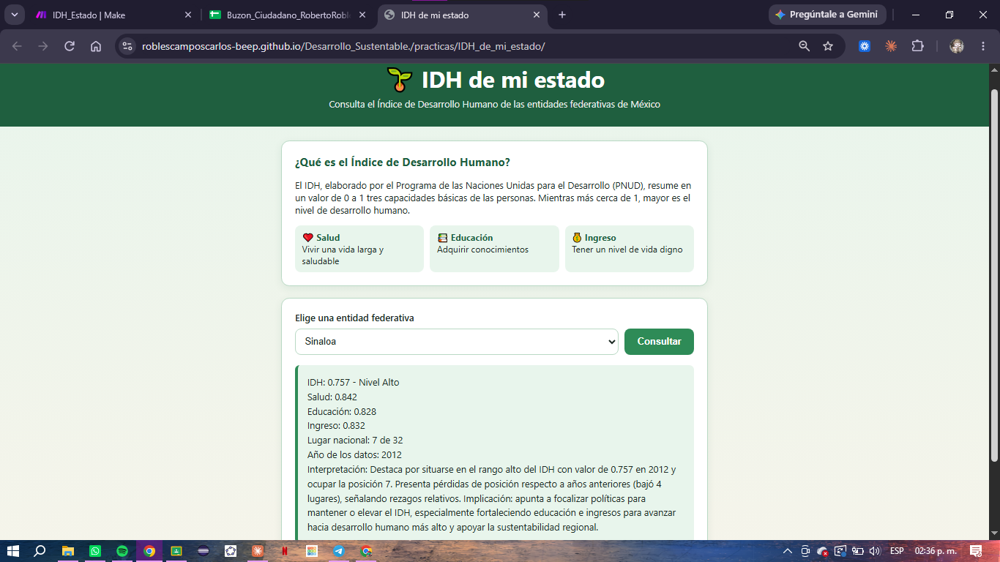

# Práctica 3.2 – Página web "IDH de mi estado"

**Tecnológico Nacional de México – Instituto Tecnológico de Mazatlán**
**Materia:** Desarrollo Sustentable
**Profesor:** Miguel Ángel Barrón Hernández
**Estudiante:** Roberto Carlos Robles Campos – No. de control 251000068
**Modalidad:** individual

- Página publicada: <https://roblescamposcarlos-beep.github.io/Desarrollo_Sustentable./practicas/IDH_de_mi_estado/>
- Fuente de datos: [`IDH_entidades.pdf`](IDH_entidades.pdf) (extracto del informe del PNUD)
- Escenario de Make: `IDH_Estado` (Webhooks → Make AI Agent → Webhook response)

---

## Actividad 1. Investigación de conceptos

### Desarrollo humano
El Programa de las Naciones Unidas para el Desarrollo (PNUD) define el desarrollo humano como el proceso de **ampliar las opciones y libertades de las personas** para que puedan vivir la vida que valoran. Se basa en el enfoque de capacidades de Amartya Sen y en el trabajo de Mahbub ul Haq. El desarrollo no se mide solo por el crecimiento económico. Se mide por lo que las personas pueden **ser y hacer**: vivir sanas, aprender y tener recursos para una vida digna.

### Índice de Desarrollo Humano (IDH) y sus tres componentes
El IDH es un indicador compuesto que va de **0 a 1**: mientras más cerca de 1, mayor desarrollo humano. Resume tres dimensiones:

| Componente | Qué representa | Cómo se mide |
|---|---|---|
| **Salud (IS)** | Vivir una vida larga y saludable | Esperanza de vida al nacer |
| **Educación (IE)** | Adquirir conocimientos | Años promedio de escolaridad y años esperados de escolarización |
| **Ingreso (II)** | Tener un nivel de vida digno | Ingreso Nacional Bruto per cápita en dólares PPC |

El IDH es la **media geométrica** de los tres índices. Por eso un rezago fuerte en una sola dimensión no se compensa del todo con las otras. Según el informe del PNUD, en 2012 las entidades se clasificaron en cuatro niveles: **muy alto** (0.760–0.830), **alto** (0.745–0.760), **medio** (0.723–0.742) y **bajo** (0.667–0.720).

### Índice de rezago social (CONEVAL) e índice de desarrollo social
- **Índice de Rezago Social (IRS)**, del CONEVAL. Resume en un solo número varias carencias sociales: rezago educativo, acceso a servicios de salud, calidad y espacios de la vivienda, servicios básicos en la vivienda y activos del hogar. Los componentes se ponderan con la técnica de *componentes principales*. Con el índice se ordenan entidades, municipios y localidades en **cinco grados de rezago**: muy bajo, bajo, medio, alto y muy alto. **No es una medición de pobreza** porque no incluye el ingreso, pero sí muestra las carencias asociadas a ella. Se calcula con los censos y conteos de población (2000, 2005, 2010, 2015 y 2020).
- **Índice de desarrollo social.** Es la mirada "en positivo" del mismo fenómeno: mide qué tanto se satisfacen las necesidades básicas de la población (educación, salud, vivienda, servicios, bienes durables). Un índice de desarrollo social alto corresponde a un rezago social bajo, y al revés.
- A diferencia del IDH, el IRS **sí llega hasta la localidad**. Por eso sirve para ver diferencias dentro de un mismo estado.

### Diferencia entre desarrollo urbano y rural
- **Urbano:** localidades de 2,500 habitantes o más (criterio del INEGI). Tienen más acceso a servicios (agua entubada, drenaje, hospitales, universidades), empleo formal y transporte. Al mismo tiempo enfrentan problemas propios: crecimiento desordenado, contaminación, tráfico y desigualdad entre colonias.
- **Rural:** localidades de menos de 2,500 habitantes. La población está dispersa y depende más de actividades primarias (agricultura, pesca, ganadería). Las escuelas y clínicas quedan lejos, los ingresos son más bajos y hay más carencias en la vivienda. También es donde se conservan muchos recursos naturales y saberes tradicionales.
- Para el desarrollo sustentable la diferencia importa: un promedio estatal alto puede esconder comunidades rurales con rezago muy alto.

---

## Actividad 2. Archivo de conocimiento `IDH_entidades.pdf`

Del informe *Índice de Desarrollo Humano para las Entidades Federativas, México 2015* (PNUD) se guardaron **solo 4 páginas**:

| Página del PDF | Página del informe | Contenido |
|---|---|---|
| 1 | 7 | **Cuadro 1**: categorías de desarrollo humano (rangos de muy alto, alto, medio y bajo) |
| 2 | 9 | **Cuadro 2**: IDH 2008, 2010 y 2012, y posición nacional de las 32 entidades |
| 3 | 10 | **Cuadro 3** (parte izquierda): Índice de Salud y parte del Índice de Educación |
| 4 | 11 | **Cuadro 3** (parte derecha): Índice de Educación 2012 e Índice de Ingreso |

Se incluyó el Cuadro 1 porque el formato de respuesta pide el **nivel** del IDH, y ese dato no viene en las tablas de valores. El archivo pesa **143 KB**, contra el informe completo de 24 páginas; así cada consulta gasta menos créditos. **Los datos corresponden a 2012.**

---

## Actividades 3 a 7. Escenario en Make

| # | Módulo | Configuración |
|---|---|---|
| 1 | **Webhooks → Custom webhook** | Recibe el campo `entidad` que envía la página (estructura detectada automáticamente) |
| 2 | **Make AI Agent** | Conexión *Make's AI Provider*, Knowledge = `IDH_entidades.pdf`, Input = `Entidad: {{1.entidad}}`, Instrucciones de la práctica (analista de desarrollo humano, solo datos del archivo, texto plano, formato fijo) |
| 3 | **Webhooks → Webhook response** | Status `200`, Body = respuesta del agente, headers `Content-Type: text/plain; charset=utf-8` y `Access-Control-Allow-Origin: *` |

Programación: **Immediately** (se ejecuta cada vez que llega una consulta).

**Problemas que encontré y cómo los resolví:**
1. Las primeras consultas respondían *"No encontré datos de esa entidad en el documento."* El PDF se había subido pero **no quedó guardado dentro del módulo Knowledge**: la lista de archivos estaba vacía. Se volvió a agregar y se guardó el escenario.
2. Al guardar desde el editor se **borraron las Instrucciones** del agente y el Input quedó como `{{1.entidad}}`. Se restauraron las Instrucciones originales y el Input `Entidad: {{1.entidad}}`.

## Actividad 4. Página `index.html`

La página ([`index.html`](index.html)) tiene un encabezado, una explicación breve del IDH con sus tres componentes, una lista con las 32 entidades (Sinaloa seleccionada por defecto) y un botón **Consultar**. El botón envía la entidad al webhook con `fetch` (POST) y muestra la respuesta en texto plano. Mientras espera, el botón se desactiva y dice *"Consultando..."*. Si algo falla, muestra *"No se pudo obtener la información, intenta de nuevo."*

---

## Actividad 8. Publicación, consultas y verificación

### Consultas realizadas desde la página publicada

| Sinaloa | Ciudad de México (IDH más alto) | Chiapas (IDH más bajo) |
|---|---|---|
|  |  |  |

### Tabla de verificación: IA vs PDF

#### Sinaloa
| Entidad | Dato | Valor según la IA | Valor en el PDF | ¿Coincide? |
|---|---|---|---|---|
| Sinaloa | IDH | 0.757 | 0.757 | ✅ Sí |
| Sinaloa | Nivel | Alto | Alto (0.745–0.760) | ✅ Sí |
| Sinaloa | Salud | 0.842 | 0.832 | ❌ No (0.842 es el IS de **2008**) |
| Sinaloa | Educación | 0.828 | 0.649 | ❌ No (0.828 es el IS de **2010**) |
| Sinaloa | Ingreso | 0.832 | 0.805 | ❌ No (0.832 es el IS de **2012**) |
| Sinaloa | Lugar nacional | 7 de 32 | 11 de 32 | ❌ No (7 era su lugar en **2008**) |
| Sinaloa | Año de los datos | 2012 | 2012 | ✅ Sí |

#### Ciudad de México (Distrito Federal en el informe)
| Entidad | Dato | Valor según la IA | Valor en el PDF | ¿Coincide? |
|---|---|---|---|---|
| Ciudad de México | IDH | 0.830 | 0.830 | ✅ Sí |
| Ciudad de México | Nivel | Muy alto | Muy alto (0.760–0.830) | ✅ Sí |
| Ciudad de México | Salud | 0.857 | 0.857 | ✅ Sí |
| Ciudad de México | Educación | 0.779 | 0.783 | ❌ No (0.779 es el IE de **2010**) |
| Ciudad de México | Ingreso | 0.802 | 0.852 | ❌ No (0.802 es el II de Aguascalientes, **otro renglón**) |
| Ciudad de México | Lugar nacional | 1 de 32 | 1 de 32 | ✅ Sí |
| Ciudad de México | Año de los datos | 2012 | 2012 | ✅ Sí |

#### Chiapas
| Entidad | Dato | Valor según la IA | Valor en el PDF | ¿Coincide? |
|---|---|---|---|---|
| Chiapas | IDH | 0.667 | 0.667 | ✅ Sí |
| Chiapas | Nivel | Bajo | Bajo (0.667–0.720) | ✅ Sí |
| Chiapas | Salud | 0.796 | 0.805 | ❌ No (0.796 es el IS de **2008**) |
| Chiapas | Educación | 0.799 | 0.528 | ❌ No (0.799 es el IS de **2010**) |
| Chiapas | Ingreso | 0.805 | 0.700 | ❌ No (0.805 es el IS de **2012**) |
| Chiapas | Lugar nacional | 32 de 32 | 32 de 32 | ✅ Sí |
| Chiapas | Año de los datos | 2012 | 2012 | ✅ Sí |

**Resumen:** de 21 datos verificados, **12 coinciden (57 %)** y **9 no coinciden (43 %)**.

- El IDH, el nivel, el año y, en 2 de 3 casos, el lugar nacional **sí coinciden**. Esos datos vienen del Cuadro 2, una tabla sencilla donde cada renglón tiene el nombre de la entidad.
- Los **componentes salieron mal en las tres entidades**. En Sinaloa y Chiapas la IA tomó los tres valores del **Índice de Salud** (2008, 2010 y 2012) y los reportó como Salud, Educación e Ingreso. En Ciudad de México mezcló años y hasta un renglón de otra entidad.
- La causa probable es que el Cuadro 3 ocupa **dos páginas**, y en la segunda (Educación 2012 e Ingreso) **no aparecen los nombres de las entidades**. La IA no supo a qué renglón correspondía cada valor y "rellenó" con números que sí estaban junto al nombre.
- El lugar de Sinaloa (7) corresponde a 2008, aunque la misma respuesta dice que "bajó 4 lugares". Es una contradicción interna: 7 + 4 = 11, que es el dato correcto de 2012.

### Créditos consumidos (historial del escenario)

| Consulta | Duración | Operaciones | Créditos |
|---|---|---|---|
| 1 | 17.5 s | 4 | 5.29 |
| 2 | 9.8 s | 4 | 4.87 |
| 3 | 18.4 s | 4 | 5.39 |
| **Promedio** | **15.2 s** | **4** | **≈ 5.2 créditos por consulta** |

Antes de cargar bien el archivo, cada consulta gastaba entre 3.3 y 5.3 créditos y respondía "no encontré datos". **Gastar créditos no garantiza una respuesta útil.**

---

## Preguntas de reflexión

**1. ¿En qué componente tiene Sinaloa su mayor fortaleza y su mayor rezago? ¿Coincide con lo que observas en tu comunidad?**
Según el PDF, la **mayor fortaleza** de Sinaloa es la **educación**: con un IE de 0.649 ocupa el **5.º lugar nacional**. El **mayor rezago** es la **salud**: con un IS de 0.832 está en el **lugar 24 de 32**. Entre 2008 y 2012 perdió 13 posiciones en salud, la caída más grande del país en esa dimensión. En ingreso está a media tabla (0.805, lugar 14) y también bajó 5 lugares. Coincide con lo que se ve en Mazatlán: hay muchas escuelas, preparatorias y universidades como el Tec, pero la salud se ve afectada por la saturación de hospitales públicos, enfermedades crónicas y la violencia. La violencia reduce la esperanza de vida, que es justo lo que mide el índice de salud.

**2. ¿Qué explica la diferencia entre la entidad con mayor y menor IDH? ¿Es un tema de justicia y equidad?**
Ciudad de México (0.830) y Chiapas (0.667) están en los extremos. La brecha más grande está en **educación**: el IE de la capital (0.783) es 48.3 % mayor que el de Chiapas (0.528). En ingreso la diferencia es 0.852 contra 0.700. Lo explican la concentración histórica de inversión, servicios, empleos formales y universidades en la capital, frente a un estado con mucha población rural dispersa e indígena y menos infraestructura. **Sí es un tema de justicia y equidad**: nacer en Chiapas o en la Ciudad de México no debería decidir cuántos años vas a estudiar o cuánto vas a vivir. El desarrollo sustentable exige reducir esas brechas, y no solo subir el promedio nacional.

**3. ¿Qué diferencias urbano-rurales de Sinaloa esconde el promedio estatal?**
El 0.757 de Sinaloa es un promedio. Mezcla ciudades como Culiacán, Mazatlán y Los Mochis, con hospitales, universidades y empleo formal, con **municipios serranos** como Badiraguato, Choix, Cosalá o San Ignacio, donde las clínicas y escuelas quedan lejos, hay menos servicios en la vivienda y el ingreso depende de actividades primarias. También esconde a los **jornaleros agrícolas** de los valles, con trabajos temporales y viviendas precarias, y a las comunidades pesqueras. Para ver esas diferencias se necesitan datos municipales o por localidad, como el Índice de Rezago Social del CONEVAL o el IDH municipal.

**4. ¿Qué riesgo hay en decidir con datos de 2012? ¿Por qué no hay datos más recientes por entidad?**
El riesgo es diseñar políticas para una realidad que ya cambió. Desde 2012 pasaron la pandemia de COVID-19 (que bajó la esperanza de vida), cambios en programas sociales, en el empleo y en la seguridad. Una decisión con datos de hace más de 10 años puede mandar recursos a donde ya no hacen falta y olvidar a quien hoy está peor. No hay datos más recientes por entidad con esta misma metodología porque el IDH estatal **depende de un informe especial del PNUD**, que necesita estimar el ingreso por entidad y combinar censos y encuestas. Ese informe no se publica cada año. El PNUD publicó después el *Informe de Desarrollo Humano Municipal 2010–2020* (2023), pero tiene otra escala y otra metodología. Por eso siempre hay que revisar el **año** de los datos antes de usarlos.

**5. ¿La IA respetó los datos del PDF? ¿Qué aprendiste sobre verificar lo que responde?**
**Solo en parte.** Acertó el IDH, el nivel y el año en las 3 entidades, pero **falló los componentes en las 3** y el lugar de Sinaloa. En total, 9 de 21 datos estaban mal, aunque la instrucción decía *"No inventes cifras"*. Lo peligroso es que las respuestas **se ven correctas**: tienen formato limpio, números con tres decimales y una interpretación convincente. Si no hubiera comparado con el PDF, habría creído que Sinaloa tiene un índice de educación de 0.828, cuando en realidad es 0.649. Aprendí que:
- La IA **no reemplaza la fuente**: hay que verificar cada cifra contra el documento original.
- El **formato del archivo importa**: una tabla partida en dos páginas, sin nombres en la segunda, confunde al modelo. Una tabla limpia con una entidad por renglón daría mejores resultados.
- Que la IA diga "según el documento" no prueba que lo haya leído bien. Tampoco basta con revisar un dato: Ciudad de México tuvo 5 de 7 aciertos y aun así falló el ingreso.

---

## Fuentes
- PNUD México (2015). *Índice de Desarrollo Humano para las Entidades Federativas, México 2015*. Cuadros 1, 2 y 3 (datos 2012).
- PNUD México (2023). [Informe de Desarrollo Humano Municipal 2010–2020: una década de transformaciones locales en México](https://www.undp.org/es/node/381116).
- CONEVAL. [Índice de Rezago Social 2020 – comunicado](https://WWW.CONEVAL.ORG.MX/SalaPrensa/Comunicadosprensa/Documents/2021/COMUNICADO_04_INDICE_REZAGO_SOCIAL_2020.pdf) y [nota técnica](https://WWW.CONEVAL.ORG.MX/Medicion/Documents/Rezago_Social_Longitudinal/2020/Nota_tecnica.pdf).
- INEGI. Criterio de población rural (localidades con menos de 2,500 habitantes).
